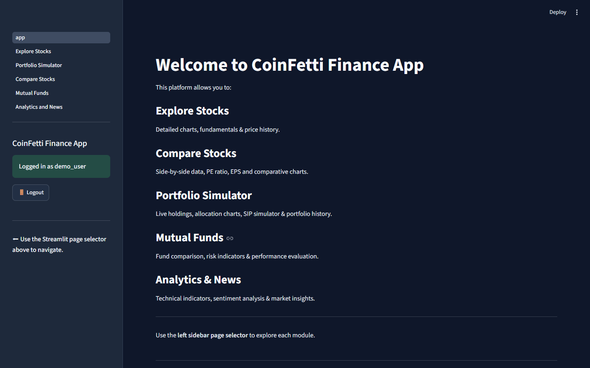
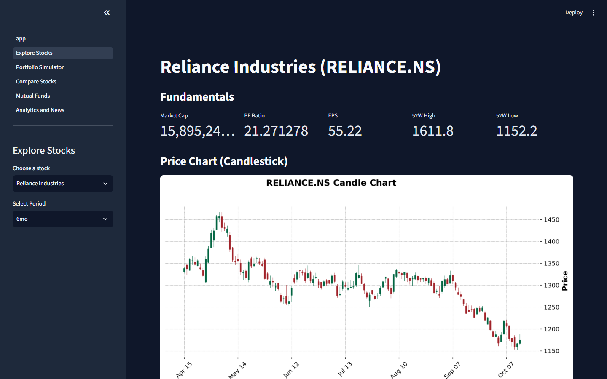
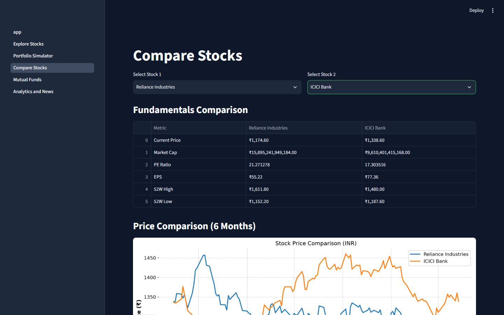
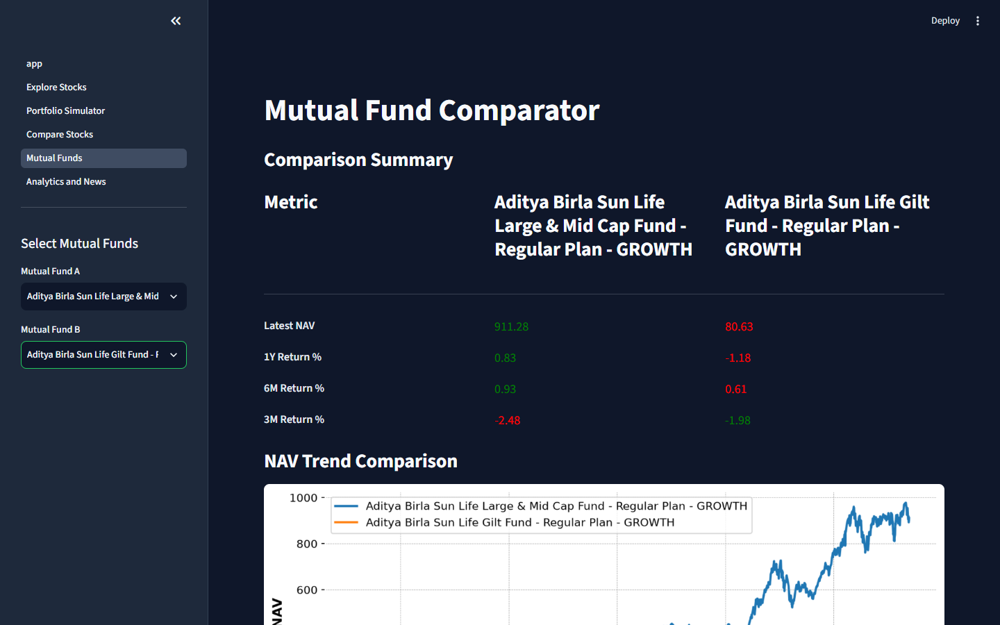
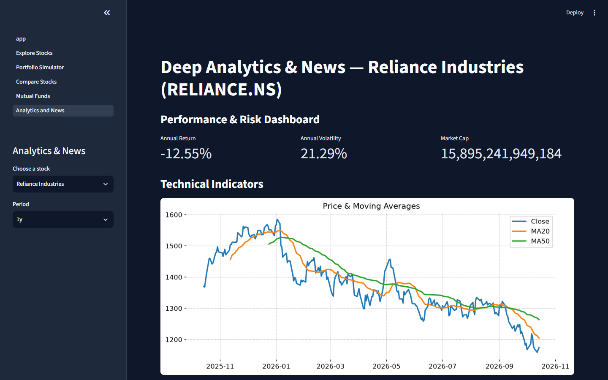
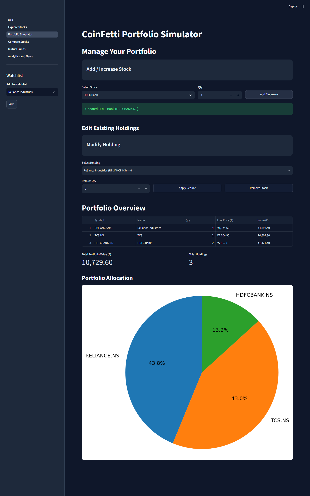

# CoinFetti — Finance Analytics App

A Streamlit web app for exploring stocks and mutual funds, comparing them side by side,
and tracking a simple personal portfolio. Prices and fundamentals come live from Yahoo
Finance (via `yfinance`) and mutual-fund NAVs from MFAPI.in. Global stocks are shown in
INR so Indian and global holdings can be compared on one scale.

> Educational project. Prices are indicative, there is no trading or payment integration,
> and nothing here is financial advice.

## Screenshots

| Home | Explore stocks |
|---|---|
|  |  |
| **Compare stocks** | **Mutual funds** |
|  |  |
| **Analytics & news** | **Portfolio** |
|  |  |

## Features

- **Accounts** — sign up / log in; each user gets their own saved portfolio and watchlist
- **Explore Stocks** — fundamentals (market cap, P/E, EPS, 52-week range) and a candlestick
  price chart over a selectable period, for popular Indian (NSE) and global stocks
- **Compare Stocks** — two stocks side by side: fundamentals table and a 6-month price
  comparison, normalised to INR
- **Portfolio Simulator** — add, increase, reduce or remove holdings; live prices, total
  value, allocation pie chart, and a persistent watchlist
- **Mutual Funds** — pick two funds from major AMCs and compare latest NAV, 1Y / 6M / 3M
  returns and the NAV trend
- **Analytics & News** — 20/50-day moving averages, RSI, annualised return and volatility,
  and the latest news headlines for the selected stock

## Tech stack

| Layer | Technology |
|---|---|
| UI | Streamlit (multipage app) |
| Market data | `yfinance` (Yahoo Finance), MFAPI.in for mutual funds |
| Data / charts | pandas, numpy, matplotlib, mplfinance |
| Storage | Local JSON files (users and per-user portfolios) |

## Getting started

```
python -m venv venv
venv\Scripts\activate          # macOS/Linux: source venv/bin/activate
pip install -r requirements.txt
streamlit run app.py
```

The app opens at <http://localhost:8501>. Create an account on the **Signup** tab, then
log in. An internet connection is required for live prices.

## Project layout

```
app.py                       Entry point: login / signup gate and landing page
auth.py                      Login, signup and logout
storage.py                   JSON persistence for users and portfolios
theme.py                     Custom CSS on top of the Streamlit theme
.streamlit/config.toml       Dark theme colours
pages/
  1_Explore_Stocks.py
  2_Portfolio_Simulator.py
  3_Compare_Stocks.py
  4_Mutual_Funds.py
  5_Analytics_and_News.py
```

User accounts and portfolios are written to a `data/` folder at runtime; it is created
automatically and is not part of the repository.

## Known limitations

- **Authentication is demo-grade.** Passwords are hashed with unsalted SHA-256 and stored
  in a local JSON file, and sessions live only in Streamlit session state. Don't reuse a
  real password, and don't deploy this as-is for real users.
- Portfolios are stored on the machine running the app, not in a database.
- USD → INR conversion uses a fixed rate (`USD_INR = 90.0` in the pages), not a live one.
- Yahoo Finance data is unofficial and can be rate-limited or occasionally empty; the news
  section shows a notice when no headlines come back.
- The stock lists are small, fixed sets of popular tickers.
